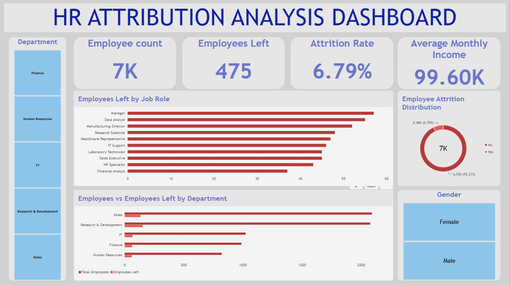
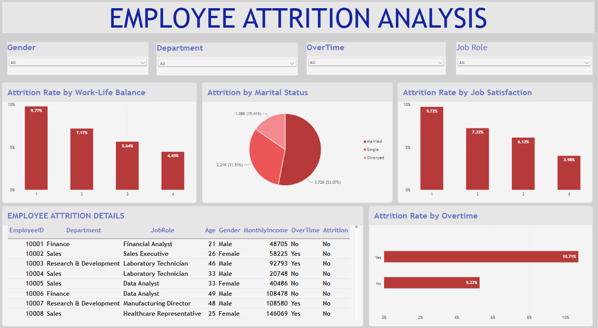
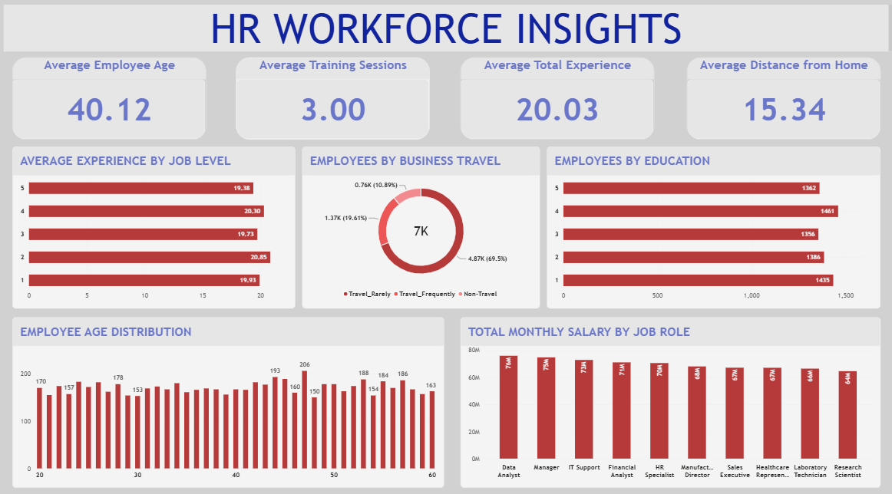

# HR Attrition Analysis

## Project Overview
This project analyzes employee attrition and workforce trends using Python, MySQL, and Power BI. The objective is to explore employee data, identify patterns associated with attrition, and present workforce insights through an interactive dashboard.

## Business Problem
Employee attrition can affect workforce stability and organizational planning. This project explores employee demographics, job roles, satisfaction, overtime, compensation, and other workforce factors to help understand attrition patterns and support data-driven HR decisions.

## Project Objectives
- Analyze overall employee attrition
- Explore attrition across departments and job roles
- Examine the relationship between attrition and overtime
- Analyze job satisfaction and work-life balance
- Explore employee demographics, income, experience, and training
- Build an interactive dashboard to present HR insights

## Tools & Technologies
- **Python:** Pandas, Matplotlib, Seaborn, data exploration and analysis
- **MySQL:** SQL queries, filtering, grouping, aggregation, and business analysis
- **Power BI:** Data modeling, interactive dashboards, and visualization

## Project Workflow
1. Imported and explored the HR dataset using Python
2. Examined data types, missing values, duplicates, and categorical values
3. Conducted exploratory analysis of employee attrition
4. Used MySQL queries to answer HR-related business questions
5. Developed an interactive Power BI dashboard to visualize workforce and attrition patterns

## Dashboard

## Power BI Dashboard

### 1. HR Overview

### 2. Attrition Analysis

### 3. Workforce Insights

## Key Analysis Areas
- Employee attrition and retention patterns
- Department and job-role analysis
- Overtime and job satisfaction
- Work-life balance
- Employee demographics
- Income and experience
- Education, training, and business travel

## Project Files
- [Python Analysis](Python/)
- [MySQL Queries](SQL/)
- [Power BI Dashboard](PowerBI/)

## 📄 Project Report

The complete project documentation is available in the Report folder.

📂 [View Project Report](Report/HR_Attrition_Analysis_Complete_Project_Report.pdf)

## Conclusion
This project demonstrates an end-to-end HR analytics workflow, from data exploration and SQL-based analysis to interactive Power BI dashboard development. It provides a structured view of workforce trends and employee attrition to support HR decision-making.
